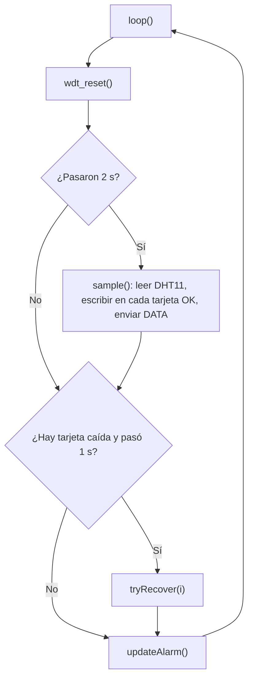
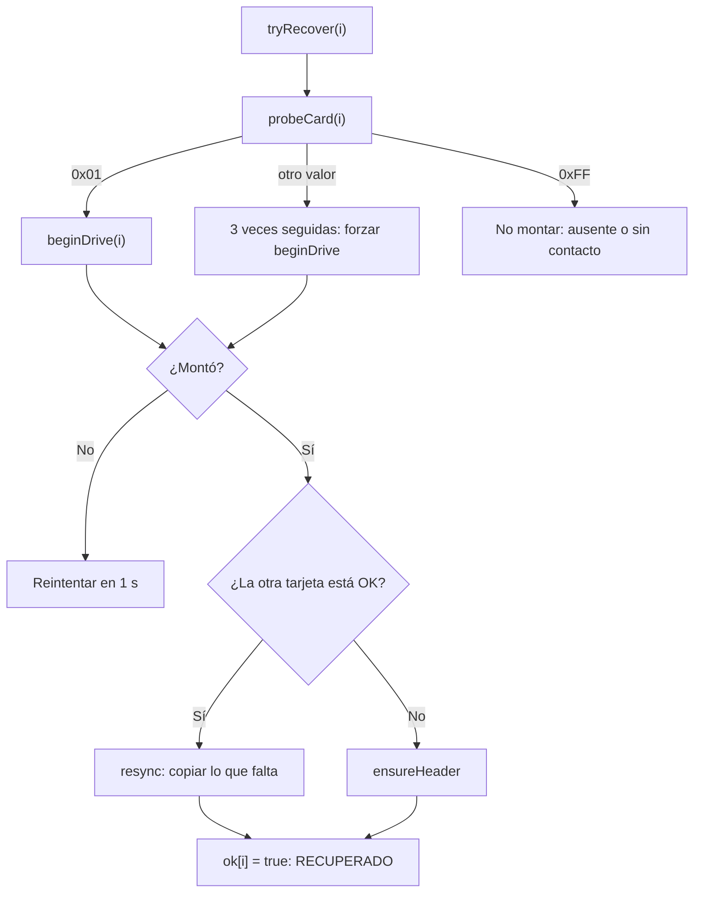

# Mini-RAID 1 embebido — Data logger con espejo en dos tarjetas microSD

Firmware para **Arduino Uno** que guarda cada muestra ambiental (temperatura y humedad) en **dos tarjetas microSD al mismo tiempo**, como un RAID 1 (espejo). Si una tarjeta se extrae en caliente, el sistema detecta la falla, activa una alarma y **sigue guardando en la tarjeta restante**. Cuando la tarjeta vuelve, se reconstruye la copia automáticamente.

Los datos y eventos se envían por el puerto serie en un formato fijo (`DATA:` y `LOG:`) para que un panel web o un monitor serie puedan mostrarlos.

## Contenido

- [Características](#características)
- [Hardware y conexiones](#hardware-y-conexiones)
- [Dependencias](#dependencias)
- [Cómo está organizado el código](#cómo-está-organizado-el-código)
- [Constantes y variables globales](#constantes-y-variables-globales)
- [Referencia de funciones](#referencia-de-funciones)
- [Flujo de ejecución](#flujo-de-ejecución)
- [Estados del sistema y alarmas](#estados-del-sistema-y-alarmas)
- [Formato de la salida serie](#formato-de-la-salida-serie)
- [Formato del archivo CSV](#formato-del-archivo-csv)
- [Cómo compilar y cargar](#cómo-compilar-y-cargar)
- [Demostración de tolerancia a fallos](#demostración-de-tolerancia-a-fallos)
- [Causa del último reinicio (MCUSR)](#causa-del-último-reinicio-mcusr)
- [Limitaciones conocidas](#limitaciones-conocidas)

## Características

- Escritura en espejo de un archivo `datalog.csv` en dos tarjetas por el bus **SPI**.
- Sistema de archivos **FAT32** gestionado con la librería SdFat.
- Detección rápida de una tarjeta ausente con una **sonda CMD0**, sin bloquear el programa.
- Modo degradado: con una sola tarjeta sigue guardando datos.
- Recuperación automática y **rebuild**: copia a la tarjeta que volvió lo que se escribió mientras estuvo fuera.
- Alarma con LED y buzzer (tres niveles: normal, degradado, crítico).
- **Watchdog** de 8 s para reiniciar la placa si el programa se bloquea.
- Un solo objeto de tarjeta compartido por las dos para ahorrar RAM (el Uno solo tiene 2 KB).

## Hardware y conexiones

| Componente | Cantidad | Función |
|---|---|---|
| Arduino Uno | 1 | Microcontrolador que ejecuta el firmware |
| Módulo lector microSD (SPI) | 2 | Interfaz entre el Arduino y cada tarjeta |
| Tarjeta microSD (FAT32) | 2 | Almacenamiento; una copia del CSV en cada una |
| Sensor DHT11 | 1 | Mide temperatura y humedad |
| LED verde | 1 | Indica que todo está en orden |
| LED rojo o naranja | 1 | Indica alarma |
| Buzzer activo | 1 | Alarma sonora |
| Resistencias de 220 Ω | 2 | Limitan la corriente de los LEDs |
| Protoboard y cables | — | Conexiones |

### Mapa de pines

| Señal | Pin del Uno | Notas |
|---|---|---|
| SCK (ambos módulos) | 13 | Bus SPI compartido |
| MOSI (ambos módulos) | 11 | Bus SPI compartido |
| MISO (ambos módulos) | 12 | Bus SPI compartido; el firmware activa su pull-up interno |
| CS de **SD-A** | **9** | Un pin propio por tarjeta |
| CS de **SD-B** | **8** | Un pin propio por tarjeta |
| DHT11, DATA | 5 | |
| LED verde | 4 | Con resistencia de 220 Ω |
| LED de alarma | 3 | Con resistencia de 220 Ω |
| Buzzer (+) | 2 | El (−) va a GND |
| Módulos y DHT11: VCC / GND | 5V / GND | Los módulos con regulador se alimentan con 5V |

SCK, MOSI y MISO **se comparten** entre los dos módulos. Solo el CS es individual. El pin 10 (SS del Uno) se deja como salida en `setup()`: si quedara como entrada, el SPI del Uno podría dejar de funcionar como maestro.

## Dependencias

| Librería | Uso |
|---|---|
| `SPI.h` | Bus SPI de hardware (incluida en el IDE) |
| `SdFat.h` (Bill Greiman, 2.x) | Acceso a la tarjeta y sistema de archivos FAT32 |
| `DHT.h` (Adafruit DHT sensor library) | Lectura del DHT11. Requiere también *Adafruit Unified Sensor* |
| `avr/wdt.h` | Watchdog del microcontrolador AVR (incluida en el IDE) |

## Cómo está organizado el código

El archivo se puede leer en seis bloques:

1. **Configuración**: constantes `#define`, pines y variables globales.
2. **Bajo nivel de tarjeta**: `releaseAllCS`, `resetSpiBus`, `probeCard`, `beginDrive`, `mountDrive`.
3. **Operaciones de archivo**: `ensureHeader`, `appendLine`, `writeWithRetry`.
4. **Tolerancia a fallos**: `markFailed`, `resync`, `tryRecover`.
5. **Salidas**: `updateAlarm` (LEDs y buzzer) y los mensajes por serie.
6. **Programa principal**: `sample`, `setup` y `loop`.

## Constantes y variables globales

| Nombre | Valor / tipo | Qué hace |
|---|---|---|
| `N_DRIVES` | 2 | Cantidad de tarjetas en espejo |
| `FILE_NAME` | `"datalog.csv"` | Nombre del archivo en cada tarjeta |
| `CSV_HEADER` | `"ms,seq,temp_c,hum_pct\n"` | Encabezado del CSV |
| `SAMPLE_MS` | 2000 | Una muestra cada 2 segundos |
| `RETRY_MS` | 1000 | Cada cuánto se intenta recuperar una tarjeta caída |
| `CS_PIN[2]` | `{ 9, 8 }` | Pin CS de cada tarjeta |
| `NAMES[2]` | `"SD-A"`, `"SD-B"` | Nombres para los mensajes |
| `MISO_PIN` | 12 | Pin MISO, al que se le activa el pull-up |
| `sd` | `SdFat32` | **Un solo** objeto de sistema de archivos para las dos tarjetas |
| `dht` | `DHT` | Objeto del sensor |
| `ok[2]` | `bool` | `true` si esa tarjeta está operativa |
| `lastTry[2]` | `uint32_t` | Momento (en ms) del último intento de recuperación |
| `probeFails[2]` | `uint8_t` | Veces seguidas que la tarjeta respondió algo atípico |
| `skipProbe[2]` | `bool` | Si la tarjeta ya se aceptó con una respuesta atípica |
| `seqNo` | `uint32_t` | Número de muestra, empieza en 1 |
| `lastSample` | `uint32_t` | Momento de la última muestra |

## Referencia de funciones

| Función | Qué hace | Devuelve |
|---|---|---|
| `freeRam()` | Calcula la RAM libre entre el heap y la pila | bytes libres |
| `releaseAllCS()` | Pone todos los CS en alto (ninguna tarjeta seleccionada) | — |
| `resetSpiBus()` | Reinicia el SPI y activa el pull-up de MISO | — |
| `probeCard(i)` | Manda CMD0 y devuelve la respuesta de la tarjeta | `0x01`, `0xFF` u otro |
| `beginDrive(i)` | Inicialización completa de SdFat para la tarjeta `i` | `true` si montó |
| `mountDrive(i)` | Comprueba presencia con la sonda y luego monta | `true` si montó |
| `ensureHeader(i)` | Crea el CSV con encabezado si no existe | `true` si quedó listo |
| `appendLine(i, line, len)` | Agrega una línea al CSV de la tarjeta `i` | `true` si se escribió completa |
| `writeWithRetry(i, line, len)` | Llama a `appendLine` hasta 2 veces | `true` si alguna salió bien |
| `markFailed(i)` | Marca la tarjeta como caída y avisa | — |
| `resync(bad, good)` | Copia a la tarjeta `bad` lo que le falta desde `good` | `true` si terminó |
| `tryRecover(i)` | Intenta volver a montar una tarjeta caída | — |
| `updateAlarm()` | Enciende LEDs y buzzer según el estado | — |
| `sample()` | Lee el sensor, escribe en las tarjetas y envía `DATA:` | — |
| `setup()` | Inicializa todo y arranca el watchdog | — |
| `loop()` | Ciclo principal | — |

### `freeRam()`

Mide cuánta memoria RAM queda libre comparando la dirección de una variable local (la cima de la pila) con el final del heap. Se envía en cada trama `DATA:` para vigilar que el Uno no se quede sin memoria.

### `releaseAllCS()`

Recorre los pines CS, los configura como salida y los pone en `HIGH`. En SPI una tarjeta solo escucha cuando su CS está en `LOW`, así que al dejar todos en alto se evita que una tarjeta responda cuando se habla con la otra. Se llama antes y después de cada operación.

### `resetSpiBus()`

Hace `SPI.end()`, espera 100 µs y vuelve a hacer `SPI.begin()`. Después activa el **pull-up interno de MISO** (`INPUT_PULLUP`). Con ese pull-up, si no hay tarjeta la línea MISO queda en alto y se lee `0xFF`, lo que permite distinguir "ausente" de "presente".

### `probeCard(i)`

Es la **sonda de presencia**. Envía el comando CMD0 (reinicio en modo SPI) a la tarjeta `i` y lee su respuesta.

1. Libera todos los CS y reinicia el bus.
2. Hasta **3 intentos**, mientras la respuesta sea `0xFF`:
   - abre una transacción SPI a 250 kHz (modo 0);
   - manda 10 bytes `0xFF` con CS en alto (80 pulsos de reloj, más de los 74 que pide la tarjeta);
   - baja el CS de la tarjeta y envía `0x40, 0, 0, 0, 0, 0x95` (CMD0 con su CRC);
   - lee hasta 16 bytes buscando una respuesta distinta de `0xFF`;
   - sube el CS y libera el bus;
   - si siguió en `0xFF`, espera 5 ms para que una tarjeta recién insertada se estabilice.
3. Llama a `wdt_reset()` y devuelve el valor.

| Valor devuelto | Significado |
|---|---|
| `0x01` | La tarjeta está presente y quedó en estado "idle" |
| `0xFF` | No responde: ausente o sin contacto |
| Otro valor | Respuesta atípica (tarjeta presente pero rara) |

Esta sonda existe porque llamar a `sd.begin()` con una tarjeta ausente puede bloquear el programa varios segundos. La sonda responde en milisegundos.

### `beginDrive(i)`

Libera los CS y llama a `sd.begin()` con el CS de la tarjeta `i`, modo `SHARED_SPI` y reloj de **1 MHz**. Es la inicialización completa de SdFat: inicia la tarjeta y monta el volumen FAT32. Se usa un solo objeto `sd` para las dos tarjetas, por lo que cada vez que se cambia de tarjeta se vuelve a montar.

### `mountDrive(i)`

Combina las dos funciones anteriores:

1. Ejecuta `probeCard(i)`.
2. Considera la tarjeta presente si la respuesta fue `0x01`, o si `skipProbe[i]` está activo y la respuesta no fue `0xFF`.
3. Si no está presente, libera los CS y devuelve `false` sin llamar a `sd.begin()`.
4. Si está presente, llama a `beginDrive(i)`. Si eso falla, apaga `skipProbe[i]`.

### `ensureHeader(i)`

Monta la tarjeta, comprueba si `datalog.csv` existe y, si no, lo crea y escribe el encabezado `ms,seq,temp_c,hum_pct`. Se usa al arrancar y al recuperar una tarjeta.

### `appendLine(i, line, len)`

Monta la tarjeta, abre el archivo con `O_WRONLY | O_CREAT | O_APPEND`, escribe la línea y lo cierra. El cierre (`close`) vacía los buffers al disco. Devuelve `true` solo si se escribieron **todos** los bytes y el cierre fue correcto. Abrir y cerrar el archivo en cada muestra reduce el riesgo de corrupción si la tarjeta se saca de golpe.

### `writeWithRetry(i, line, len)`

Intenta `appendLine` hasta **2 veces**, con 20 ms entre intentos. Un error momentáneo del bus no dispara la alarma; una tarjeta realmente extraída falla las dos veces.

### `markFailed(i)`

Si la tarjeta estaba marcada como operativa: pone `ok[i] = false`, reinicia `skipProbe` y `probeFails`, guarda la hora en `lastTry` y envía `LOG:[ALARMA] ...`. A partir de ahí el sistema entra en modo degradado.

### `resync(bad, good)`

Es el **rebuild**. Copia a la tarjeta que volvió (`bad`) los bytes que se escribieron en la tarjeta sana (`good`) mientras estuvo fuera.

1. Envía `LOG:[REBUILD] Iniciando ...` y asegura el encabezado en `bad`.
2. Lee el tamaño del CSV en `bad` (`dstSize`) y en `good` (`srcSize`).
3. Mientras `pos < srcSize`, en trozos de **128 bytes**:
   - monta `good`, se posiciona en `pos` y lee un trozo;
   - monta `bad`, agrega el trozo al final de su CSV;
   - llama a `wdt_reset()` para que el watchdog no reinicie durante una copia larga.
4. Envía `LOG:[REBUILD] ... Bytes copiados ...` con el total.

La copia se hace por posición en bytes: el programa supone que el archivo de `bad` es un prefijo del de `good`, como ocurre cuando las dos tarjetas llevan el mismo CSV. Si `bad` ya tiene tanto o más que `good`, no se copia nada.

### `tryRecover(i)`

Intenta volver a montar una tarjeta caída. Decide según la respuesta de la sonda:

| Respuesta de `probeCard` | Qué hace |
|---|---|
| `0x01` | Reinicia `probeFails` y llama a `beginDrive` |
| Distinta de `0x01` y `0xFF` | Cuenta `probeFails`; al tercer intento seguido fuerza `beginDrive` y, si monta, activa `skipProbe` |
| `0xFF` | **No** llama a `sd.begin()`: la tarjeta está ausente o sin contacto, y así no bloquea el bus |

Si logra montar: si la otra tarjeta está operativa ejecuta `resync`; si no, solo `ensureHeader`. Si todo sale bien marca `ok[i] = true` y envía `LOG:[RECUPERADO] ...`. Si algo falla, no cambia el estado y se vuelve a intentar en `RETRY_MS`.

### `updateAlarm()`

Cuenta las tarjetas caídas y activa las salidas según el nivel. Usa `millis()` para parpadear sin bloquear el programa.

### `sample()`

1. Lee temperatura y humedad del DHT11 e incrementa `seqNo`.
2. Si la lectura es `NaN`, usa `"0.0"` y `"0"`. Si no, convierte la temperatura a décimas de grado entero y redondea la humedad (en AVR `snprintf` no soporta `%f`).
3. Arma la línea CSV `ms,seq,temp,hum\n`.
4. Para cada tarjeta operativa llama a `writeWithRetry`; si falla, `markFailed`. Llama a `wdt_reset()` tras cada tarjeta.
5. Envía la trama `DATA:` por serie y actualiza la alarma.

### `setup()`

1. Guarda `MCUSR` (causa del último reinicio), lo limpia y **desactiva el watchdog** para evitar bucles de reinicio al arrancar.
2. Inicia el puerto serie a 115200, el DHT11 y los pines de salida.
3. Deja el pin 10 como salida, libera los CS y activa el pull-up de MISO.
4. Envía `LOG:[RESET] MCUSR=...` con la causa del reinicio.
5. Monta cada tarjeta con `ensureHeader` y envía `LOG:[INICIO] ...`.
6. Al final activa el **watchdog de 8 s** con `wdt_enable(WDTO_8S)`.

### `loop()`

Llama a `wdt_reset()` y luego, cada vez:

- si pasaron `SAMPLE_MS` desde la última muestra, ejecuta `sample()`;
- para cada tarjeta caída cuyo último intento fue hace `RETRY_MS` o más, ejecuta `tryRecover()`;
- ejecuta `updateAlarm()`.

## Flujo de ejecución



### Recuperación de una tarjeta



## Estados del sistema y alarmas

| Estado | Condición | LED verde | LED de alarma | Buzzer |
|---|---|---|---|---|
| Normal | Todas las tarjetas operativas | Encendido | Apagado | Apagado |
| Degradado | Al menos una operativa y al menos una caída | Apagado | Encendido fijo | Pitidos de 200 ms cada 1 s |
| Crítico | Ninguna tarjeta operativa | Apagado | Parpadeo rápido (100 ms encendido, 100 ms apagado) | Continuo |

## Formato de la salida serie

Puerto a **115200 baudios**. Cada línea empieza con un prefijo para que un programa externo la clasifique.

### Tramas `DATA:` (una por muestra)

```
DATA:ms,seq,temp_c,hum_pct,okA,okB,ramLibre
DATA:70171,35,28.8,76,0,1,1031
```

| Campo | Significado |
|---|---|
| `ms` | Milisegundos desde el arranque |
| `seq` | Número de muestra |
| `temp_c` | Temperatura en °C |
| `hum_pct` | Humedad relativa en % |
| `okA`, `okB` | `1` si la tarjeta está operativa, `0` si no |
| `ramLibre` | RAM libre en bytes |

### Mensajes `LOG:`

| Mensaje | Cuándo sale |
|---|---|
| `LOG:[RESET] MCUSR=...` | Al arrancar, con la causa del último reinicio |
| `LOG:[SISTEMA] Inicializando ...` | Al arrancar |
| `LOG:[INICIO] SD-X: ...` | Resultado del montaje inicial de cada tarjeta |
| `LOG:[ALARMA] SD-X fallo / extraida ...` | Una tarjeta pasó a caída |
| `LOG:[REBUILD] ...` | Inicio y fin de la sincronización |
| `LOG:[RECUPERADO] SD-X ...` | La tarjeta volvió a estar operativa |

## Formato del archivo CSV

Cada tarjeta guarda `datalog.csv`. En condiciones normales los dos archivos son idénticos.

```
ms,seq,temp_c,hum_pct
2041,1,28.7,68
4041,2,28.5,68
```

## Cómo compilar y cargar

1. Instala el **IDE de Arduino 2.x**.
2. Instala las librerías de la sección [Dependencias](#dependencias) desde el *Gestor de librerías*.
3. Selecciona la placa **Arduino Uno** y el puerto correspondiente.
4. Guarda el código en una carpeta con el mismo nombre que el archivo `.ino`.
5. Cierra el Monitor Serie (o cualquier programa que use el puerto) antes de **subir**.
6. Sube el programa, abre el Monitor Serie a 115200 baudios y comprueba que aparecen `[INICIO]` y las tramas `DATA:`.

Las tarjetas deben estar formateadas en **FAT32** (se recomiendan de 32 GB o menos).

## Demostración de tolerancia a fallos

1. Con las dos tarjetas puestas debe verse el LED verde y `okA,okB` en `1,1`.
2. Extrae una tarjeta con calma, sujetando el módulo con la otra mano. Debe aparecer `LOG:[ALARMA]`, el LED de alarma fijo y el buzzer intermitente, y las tramas `DATA:` deben seguir con la otra tarjeta en `1`.
3. Reinserta la tarjeta hasta oír el clic. Debe aparecer `LOG:[REBUILD]` y luego `LOG:[RECUPERADO]`.
4. Saca las dos tarjetas, copia los `datalog.csv` a una computadora y compáralos: deben ser idénticos.

## Causa del último reinicio (MCUSR)

`setup()` imprime el registro `MCUSR` en binario, que indica por qué se reinició el microcontrolador:

| Valor impreso | Bit | Causa |
|---|---|---|
| `1` | 0 | Encendido (power-on) |
| `10` | 1 | Reset externo (botón o apertura del puerto serie) |
| `100` | 2 | Brown-out (caída de voltaje) |
| `1000` | 3 | Watchdog (el programa se bloqueó más de 8 s) |

Es útil para distinguir un problema de alimentación (`100`) de un bloqueo del programa (`1000`).

## Limitaciones conocidas

- **Watchdog y bootloader.** Algunas placas Uno compatibles traen un bootloader antiguo que no gestiona bien el watchdog y puede quedarse reiniciando tras un reset por watchdog. Si pasa, actualiza el bootloader a Optiboot o quita las llamadas a `wdt_*`.
- **Memoria.** El Uno tiene 2 KB de RAM. Por eso se usa un único objeto `SdFat32` y se vuelve a montar la tarjeta en cada operación, lo que hace cada muestra algo más lenta. Un Arduino Mega permitiría un objeto por tarjeta.
- **Rebuild por posición en bytes.** Supone que el CSV de la tarjeta que volvió es un prefijo del de la tarjeta sana. Si se reinserta una tarjeta con otro contenido, el resultado no está garantizado.
- **Lecturas inválidas del DHT11.** Si el sensor falla, el código escribe `0.0` y `0` en lugar de `NaN`; esos valores no distinguen una lectura fallida de una real.
- **DHT11.** Tiene una precisión de unos ±2 °C y ±5 % de humedad, y no debe leerse más de una vez por segundo.
- **Contactos físicos.** Los módulos y los cables deben estar bien fijos. Un cable flojo se interpreta igual que una tarjeta extraída y dispara la alarma.
- **Sin reloj de tiempo real.** Las marcas de tiempo son milisegundos desde el arranque, no fecha y hora.

## Autores

Proyecto final de **Arquitectura de Computadoras II** — Universidad Mariano Gálvez de Guatemala, Centro Universitario de Jalapa.

<!-- Agrega aquí los nombres de los integrantes del grupo -->
